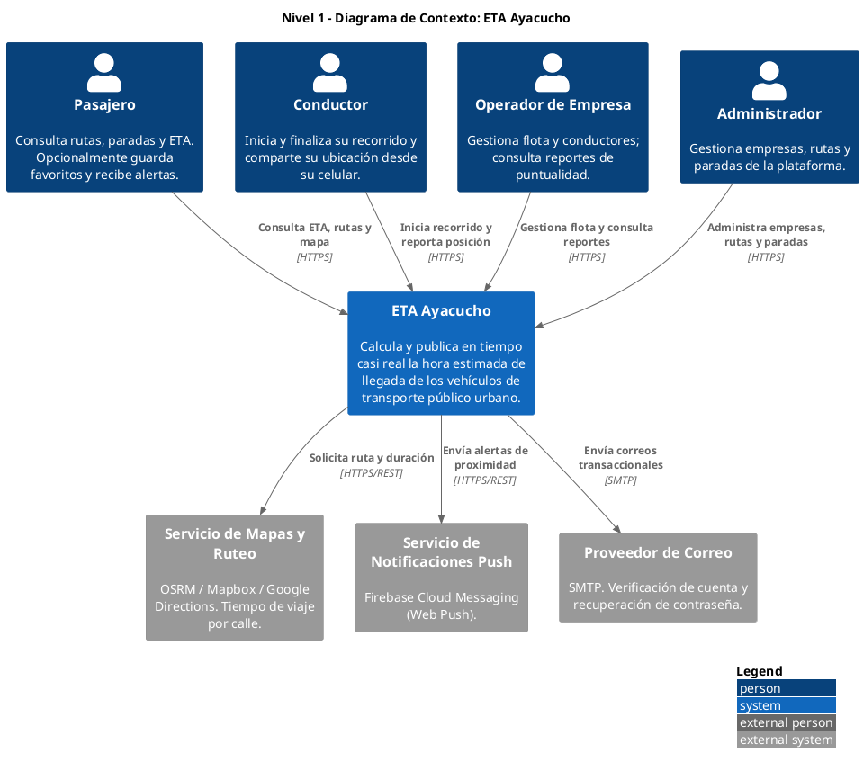
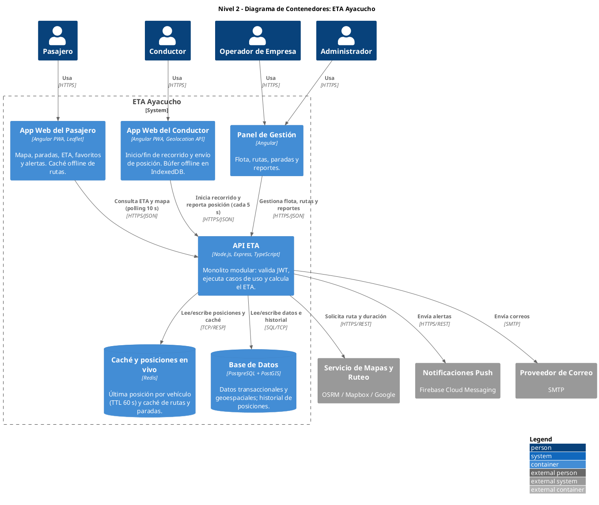
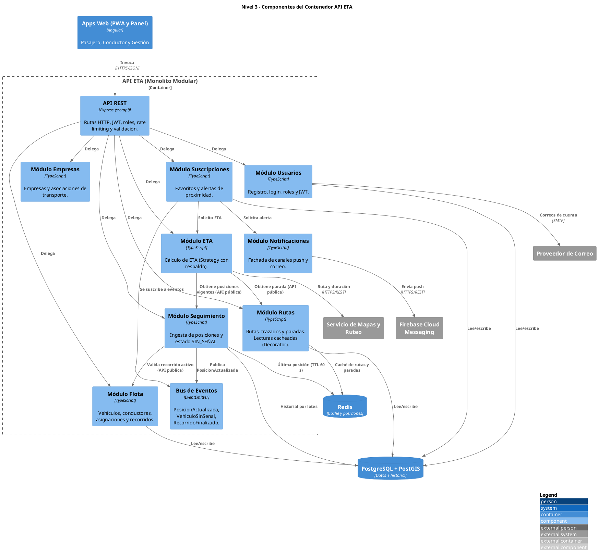
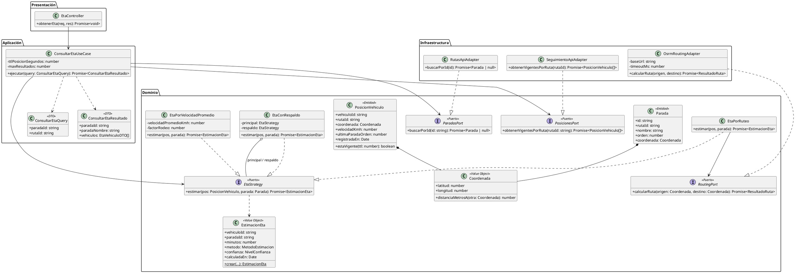
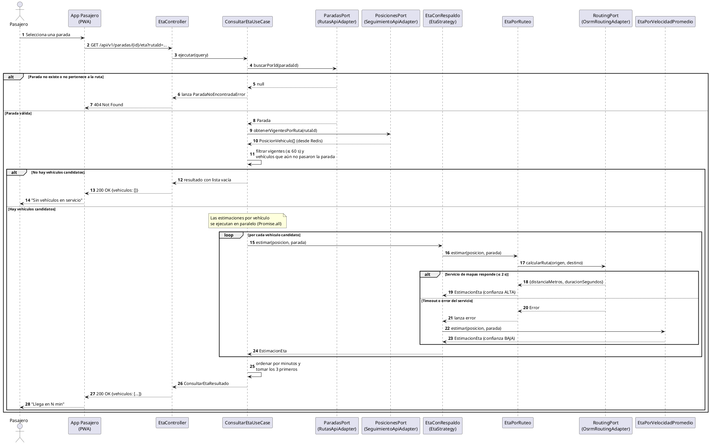
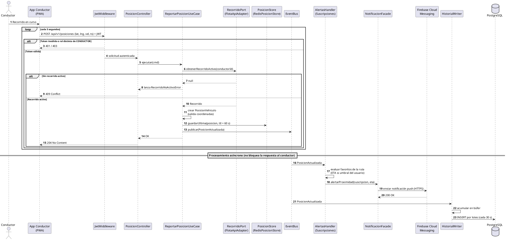
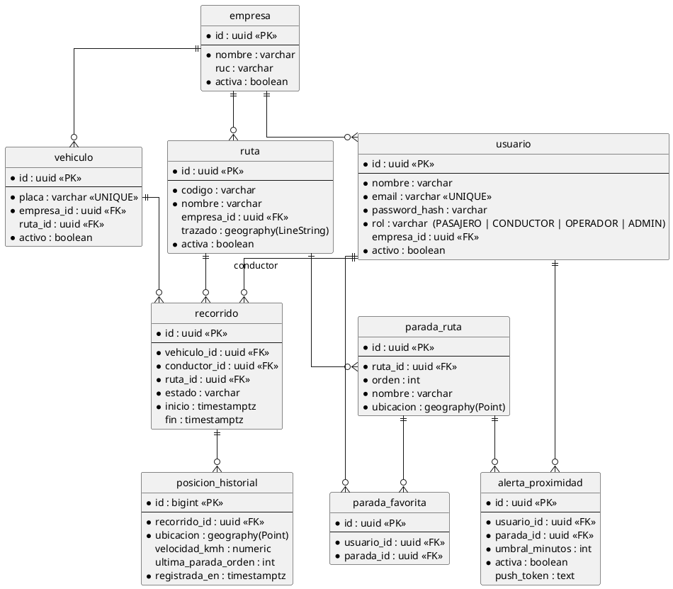
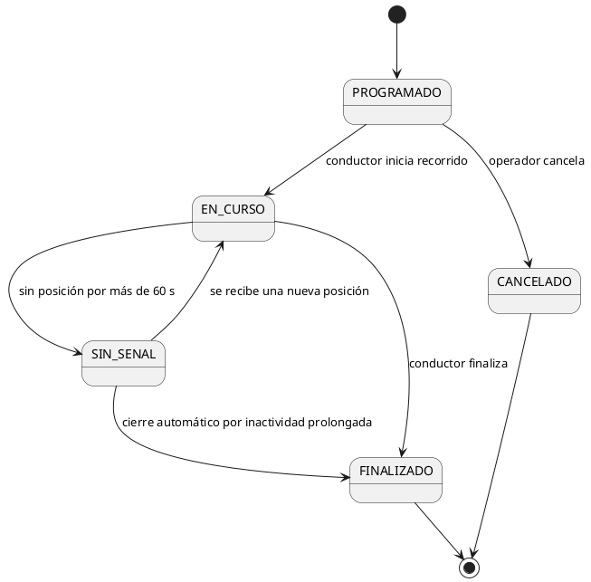

# Guía Maestra de Arquitectura y Diseño de Software: Sistema ETA para Transporte Público Urbano de Ayacucho

> **Propósito de este documento:** Compendia el análisis de requerimientos, las decisiones de ingeniería (ADRs), el modelo C4, el diseño interno por módulos y los patrones de diseño del proyecto *ETA Ayacucho* (Hora Estimada de Llegada de vehículos de transporte público urbano). Sigue la misma estructura de fases del caso de estudio GoPet, adaptada a un sistema de **seguimiento geoespacial en tiempo casi real**.

---

## 0. Cómo usar este documento (generación de diagramas)

Todos los diagramas están escritos en **PlantUML**. Para generarlos:

1. Copia el contenido de cada bloque ` ```plantuml ` (desde `@startuml` hasta `@enduml`).
2. Pégalo en <https://www.plantuml.com/plantuml> o en la extensión *PlantUML* de VS Code.
3. Exporta como PNG o SVG y pégalo donde veas el marcador **`[INSERTAR FIGURA N]`**.

> Los diagramas C4 usan la librería estándar `!include <C4/C4_Context>` (y `C4_Container`, `C4_Component`), que ya viene incluida en el servidor oficial de PlantUML y en la extensión de VS Code (esta última requiere internet la primera vez).

| Figura | Contenido | Sección |
|:---:|---|:---:|
| Fig. 1 | C4 Nivel 1: Contexto | 4.1 |
| Fig. 2 | C4 Nivel 2: Contenedores | 4.2 |
| Fig. 3 | C4 Nivel 3: Componentes (API) | 4.3 |
| Fig. 4 | C4 Nivel 4: Diagrama de clases del módulo ETA | 4.4 |
| Fig. 5 | Secuencia: Consultar ETA de una parada | 4.5 |
| Fig. 6 | Secuencia: Reportar posición del vehículo | 4.6 |
| Fig. 7 | Modelo de datos (ER) | 5.4 |
| Fig. 8 | Máquina de estados del Recorrido | 5.5 |

---

## 1. Ficha Técnica y Visión General del Proyecto

* **Nombre del Sistema:** ETA Ayacucho, plataforma de estimación de llegada para transporte público urbano.
* **Tipo de Sistema:** Aplicación web progresiva (PWA) de información en tiempo casi real, con seguimiento geoespacial de flota.
* **Problema que resuelve:** El pasajero no sabe cuánto demorará en pasar el próximo vehículo (combi, microbús, etc.) de una línea, lo que genera esperas largas e inciertas en la parada.
* **Estilo Arquitectónico Macro:** Monolito Modular en Capas (Modular Monolith).
* **Enfoque de Diseño Interno:** Arquitectura Limpia (Clean Architecture / Hexagonal, Puertos y Adaptadores).
* **Tecnologías Seleccionadas:**
  * **Frontend:** 3 aplicaciones Angular (TypeScript) en un mismo workspace: App del Pasajero (PWA), App del Conductor (PWA) y Panel de Gestión. Mapa con Leaflet + OpenStreetMap.
  * **Backend:** Node.js con Express y TypeScript.
  * **Persistencia Principal:** PostgreSQL + extensión **PostGIS** (datos relacionales y geoespaciales).
  * **Caché y estado en vivo:** Redis (última posición por vehículo con TTL y caché de rutas/paradas).
  * **Protocolos de Integración:** HTTPS / REST con JSON.
  * **Despliegue:** Contenedores Docker (docker-compose en el MVP).
* **Integraciones Externas:** Servicio de Mapas y Ruteo (OSRM / Mapbox / Google Directions), Notificaciones Push (Firebase Cloud Messaging) y Proveedor de Correo (SMTP).

### 1.1 Alcance del MVP y supuestos de diseño

| Dentro del alcance | Fuera del alcance (evolución futura) |
|---|---|
| Consulta de rutas, paradas y ETA | Venta de pasajes o pagos electrónicos |
| Mapa con vehículos en tiempo casi real | Dispositivos GPS dedicados en los vehículos |
| App del conductor que reporta su posición (celular) | Predicción con Machine Learning |
| Favoritos y alertas de proximidad | Integración con sistemas municipales |
| Gestión de empresas, flota y rutas; reportes de puntualidad | App nativa (iOS/Android) |

**Supuestos de diseño (validar con datos reales de Ayacucho):**

* Hasta **300 vehículos activos simultáneos** y **300 pasajeros concurrentes** consultando.
* Cada vehículo reporta su posición cada **5 segundos**, es decir ≈ 60 solicitudes/segundo en el pico (300 ÷ 5).
* La conectividad móvil puede ser intermitente en algunos tramos de la ciudad.
* El concepto **Empresa** incluye empresas formales y asociaciones de transportistas.
* Los parámetros (TTL de posición = 60 s, velocidad promedio urbana = 15 km/h, máximo de 3 vehículos por consulta) son **configurables** y deben calibrarse con pruebas en campo.

---

## 2. Fase 1: Análisis del Sistema y Drivers Arquitectónicos

### 2.1 Actores del Sistema

| Actor | Tipo | Rol y Responsabilidad Principal |
|---|---|---|
| **Pasajero** | Persona | Consulta rutas, paradas cercanas, ETA y mapa. Opcionalmente se registra para guardar paradas favoritas y recibir alertas de proximidad. |
| **Conductor** | Persona | Inicia y finaliza su recorrido y comparte su ubicación desde su celular mientras presta servicio. |
| **Operador de Empresa** | Persona | Administra la flota y los conductores de su empresa, asigna vehículos a rutas y consulta reportes de puntualidad. |
| **Administrador** | Persona | Gobierna la plataforma: alta y baja de empresas, rutas y paradas; auditoría de usuarios. |
| **Servicio de Mapas y Ruteo** | Sistema Externo | Calcula distancia y duración de viaje por calle entre dos puntos (OSRM / Mapbox / Google Directions). |
| **Servicio de Notificaciones Push** | Sistema Externo | Entrega alertas a los dispositivos de los pasajeros (Firebase Cloud Messaging). |
| **Proveedor de Correo** | Sistema Externo | Envía correos de verificación de cuenta y recuperación de contraseña (SMTP). |

---

### 2.2 Historias de Usuario (HU) y Requisitos Funcionales (RF)

#### Matriz de Historias de Usuario
* **HU01:** Como pasajero, quiero consultar las rutas y las paradas cercanas a mí para saber qué línea me conviene tomar.
* **HU02:** Como pasajero, quiero ver en cuántos minutos llegará el próximo vehículo a mi parada para decidir si espero o busco otra opción.
* **HU03:** Como pasajero, quiero ver en un mapa dónde están los vehículos de una ruta para seguir su avance.
* **HU04:** Como conductor, quiero iniciar y finalizar mi recorrido y compartir mi ubicación automáticamente para que los pasajeros sepan por dónde voy.
* **HU05:** Como operador, quiero gestionar mis vehículos y conductores y asignarlos a rutas para controlar mi flota.
* **HU06:** Como administrador, quiero gestionar empresas, rutas y paradas para mantener actualizada la red de transporte.
* **HU07:** Como pasajero, quiero guardar paradas favoritas y recibir una alerta cuando el vehículo esté a pocos minutos para no esperar a la intemperie.
* **HU08:** Como operador, quiero consultar reportes de puntualidad y recorridos para evaluar el servicio de mi empresa.

#### Matriz de Requisitos Funcionales y Trazabilidad
| ID | Requisito Funcional | Historia Asociada | Descripción Técnica |
|---|---|:---:|---|
| **RF01** | Consulta de rutas y paradas | HU01 | Listado de rutas y paradas; búsqueda de paradas cercanas por geolocalización (consulta espacial con PostGIS). |
| **RF02** | Consulta de ETA por parada | HU02 | Cálculo de minutos restantes de los próximos vehículos a una parada, con nivel de confianza. |
| **RF03** | Mapa de vehículos en vivo | HU03 | Posiciones vigentes de los vehículos de una ruta, actualizadas por *polling* cada 10 s. |
| **RF04** | Gestión de recorridos | HU04 | Iniciar y finalizar recorrido; un conductor solo puede tener uno activo. |
| **RF05** | Reporte de posición | HU04 | Recepción periódica (cada 5 s) de latitud, longitud, velocidad y marca de tiempo, con soporte de envío en lote tras pérdida de señal. |
| **RF06** | Gestión de flota | HU05 | CRUD de vehículos y conductores; asignación de vehículo a ruta. |
| **RF07** | Administración de red de transporte | HU06 | CRUD de empresas, rutas (con trazado) y paradas ordenadas. |
| **RF08** | Paradas favoritas | HU07 | Agregar, listar y quitar favoritos del pasajero autenticado. |
| **RF09** | Alertas de proximidad | HU07 | Notificación push cuando el ETA de un vehículo a una parada favorita sea menor o igual al umbral del usuario. |
| **RF10** | Reportes de puntualidad | HU08 | Historial de recorridos y comparación entre tiempos estimados y reales por ruta. |
| **RF11** | Autenticación y roles | Transversal | Registro, login, JWT y autorización por rol (PASAJERO, CONDUCTOR, OPERADOR, ADMIN). La consulta de ETA y mapa es **pública**. |

---

### 2.3 Atributos de Calidad (AC) y Restricciones (RC)

#### Atributos de Calidad (No Funcionales)
* **AC01 - Rendimiento:** La consulta de ETA y del mapa debe responder con baja latencia aun con muchos pasajeros consultando a la vez.
* **AC02 - Disponibilidad y tolerancia a fallos externos:** Si el servicio de mapas falla, el sistema debe degradarse con elegancia y seguir entregando un ETA aproximado.
* **AC03 - Escalabilidad:** Debe absorber el crecimiento de vehículos y pasajeros sin reescritura estructural.
* **AC04 - Seguridad y privacidad:** Control de acceso por roles, cifrado en tránsito y protección de la ubicación del conductor.
* **AC05 - Mantenibilidad:** Alto desacoplamiento para poder cambiar el proveedor de mapas o el algoritmo de ETA sin afectar el resto.
* **AC06 - Usabilidad y eficiencia en red móvil:** Respuestas livianas y uso correcto en celulares de gama baja y conexiones lentas.
* **AC07 - Exactitud y frescura de los datos:** El ETA debe ser razonablemente preciso y nunca basarse en posiciones obsoletas.

#### Restricciones Técnicas
* **RC01 - Aplicación Web / PWA:** Accesible desde navegadores modernos en escritorio y móvil, sin instalar apps nativas.
* **RC02 - Control de Versiones:** Código en repositorio Git con integración continua.
* **RC03 - Comunicación vía API REST:** Desacoplamiento total entre frontends y backend mediante HTTP/JSON.
* **RC04 - Geolocalización desde el celular del conductor:** En el MVP la posición proviene de la *Geolocation API* del navegador; no hay hardware GPS dedicado.
* **RC05 - Ruteo externo:** No se desarrolla un motor de ruteo propio; se integra un servicio externo mediante API.
* **RC06 - Protección de datos personales:** Cumplimiento de la Ley N.° 29733 (Protección de Datos Personales del Perú). La ubicación del conductor solo se captura durante un recorrido activo y no se expone su identidad al pasajero.
* **RC07 - Costo contenido:** Preferir componentes de código abierto y planes gratuitos (OpenStreetMap, Leaflet, OSRM) por el contexto académico.

---

### 2.4 Drivers Arquitectónicos (DA)

| ID Driver | Origen | Impacto en la Arquitectura |
|---|---|---|
| **DA01** | AC03 (Escalabilidad) | API sin estado; el estado en vivo (posiciones) vive en Redis, lo que permite replicar contenedores de la API. |
| **DA02** | AC01 (Rendimiento) | Redis como almacén de la última posición por vehículo y caché de rutas/paradas (datos casi estáticos) delante de PostgreSQL. |
| **DA03** | AC04 (Seguridad) | JWT con roles, TLS/HTTPS, *rate limiting* en endpoints públicos y variables de entorno aisladas. |
| **DA04** | AC02 + RC05 (Mapas externos) | Contrato abstracto `RoutingPort` con adaptadores intercambiables y **estrategia de respaldo** (ETA por velocidad promedio) si el proveedor falla. |
| **DA05** | RC04 (GPS del celular) | App del conductor como PWA con búfer offline (IndexedDB) y envío en lote; filtrado de lecturas de baja precisión. |
| **DA06** | AC05 (Mantenibilidad) | Clean Architecture dentro de cada módulo para proteger el dominio de frameworks, BD y proveedores. |
| **DA07** | AC06 (Usabilidad en red móvil) | Respuestas JSON compactas con compresión gzip, caché de rutas en el Service Worker de la PWA. |
| **DA08** | AC07 (Frescura) | TTL de 60 s en Redis: una posición más antigua deja de existir y el vehículo pasa a estado SIN_SEÑAL. |
| **DA09** | RF01 (Búsqueda espacial) | PostgreSQL con PostGIS e índices GiST para paradas cercanas y trazados de ruta. |

---

### 2.5 Escenarios de Atributos de Calidad (Formato SEI)

* **EQ-01 (Rendimiento):**
  * *Fuente:* Pasajero (cliente web).
  * *Estímulo:* Consulta el ETA de una parada.
  * *Artefacto:* Contenedor API ETA + Redis.
  * *Respuesta:* El 95% de las solicitudes se resuelve en un tiempo $t \le 2$ segundos con menos del 1% de errores con 300 pasajeros simultáneos.
* **EQ-02 (Disponibilidad ante falla externa):**
  * *Fuente:* Falla del Servicio de Mapas y Ruteo (caído o lento).
  * *Estímulo:* Consulta de ETA durante la indisponibilidad.
  * *Artefacto:* Módulo ETA (`EtaConRespaldo`).
  * *Respuesta:* El sistema detecta el fallo (timeout de 2 s), aplica la estrategia de respaldo y responde **HTTP 200** en $< 3$ segundos con `confianza = BAJA`, sin caerse ni devolver error al pasajero.
* **EQ-03 (Seguridad):**
  * *Fuente:* Usuario no autenticado o con rol inadecuado.
  * *Estímulo:* Intento de invocar `POST /api/v1/posiciones` o rutas de gestión (`/api/v1/vehiculos`) sin token válido o sin el rol requerido.
  * *Artefacto:* Middleware de Seguridad / API REST.
  * *Respuesta:* El 100% de las solicitudes no válidas se bloquea de inmediato con HTTP 401/403, sin revelar trazas internas.
* **EQ-04 (Frescura de datos):**
  * *Fuente:* Vehículo en recorrido que pierde conexión.
  * *Estímulo:* No se recibe posición durante más de 60 segundos.
  * *Artefacto:* Módulo Seguimiento + Redis.
  * *Respuesta:* El vehículo se excluye del cálculo de ETA y se muestra como "sin señal"; reaparece en $\le 10$ segundos tras recibir una nueva posición.
* **EQ-05 (Escalabilidad de ingesta):**
  * *Fuente:* Flota de conductores.
  * *Estímulo:* 300 vehículos envían posición cada 5 s (≈ 60 req/s).
  * *Artefacto:* Endpoint `POST /api/v1/posiciones` + Redis.
  * *Respuesta:* El 95% de los reportes se procesa en $< 500$ ms, sin pérdida de posiciones y con la escritura del historial en PostgreSQL por lotes.

---

## 3. Fase 2: Registro de Decisiones Arquitectónicas (ADRs)

### ADR-001: Estilo de Monolito Modular
* **Contexto:** Proyecto con equipo reducido, plazos académicos acotados y una flota inicial pequeña. Los microservicios añaden complejidad de despliegue, red y monitoreo que no se justifica.
* **Decisión:** Implementar un **Monolito Modular** en Node.js + Express con módulos de límites claros (Usuarios, Empresas, Rutas, Flota, Seguimiento, ETA, Suscripciones, Notificaciones), tablas separadas por módulo y comunicación interna en memoria mediante la API pública (`index.ts`) de cada módulo.
* **Consecuencias Positivas:** Un solo despliegue, simplicidad operativa y camino abierto para extraer **Seguimiento** como servicio independiente si la ingesta crece.
* **Consecuencias Negativas:** Exige disciplina para no cruzar límites modulares ni consultar tablas de otro módulo.

### ADR-002: Enfoque Interno con Clean Architecture
* **Contexto:** Las reglas de negocio (vigencia de posiciones, filtrado de vehículos que ya pasaron la parada, cálculo de ETA, estados del recorrido) son el activo principal y no deben cambiar si cambia el framework, la BD o el proveedor de mapas.
* **Decisión:** Cada módulo organiza su código en cuatro capas: **Dominio**, **Aplicación**, **Infraestructura** y **Presentación**.
* **Consecuencias Positivas:** Dominio testeable sin base de datos ni red; inversión de dependencias nativa.
* **Consecuencias Negativas:** Más archivos y clases intermedias (DTOs, puertos, mapeadores).

### ADR-003: Redis para posiciones en vivo y caché de rutas
* **Contexto:** Las posiciones cambian cada 5 s y solo interesa la **última** de cada vehículo; escribir cada una en PostgreSQL para luego leerla sería ineficiente. Además, rutas y paradas casi no cambian y se leen constantemente.
* **Decisión:** Usar Redis con dos roles: (1) almacén de la última posición por vehículo con **TTL de 60 s**; (2) caché de rutas y paradas mediante el patrón **Decorator** sobre el repositorio de Rutas (`CachedRutaRepository`).
* **Consecuencias Positivas:** Lecturas en memoria de baja latencia; el TTL implementa de forma natural el estado SIN_SEÑAL.
* **Consecuencias Negativas:** Requiere invalidar el caché cuando el administrador edita rutas o paradas; Redis pasa a ser un componente crítico a monitorear.

### ADR-004: Desacoplamiento del Servicio de Mapas mediante Puertos y Adaptadores
* **Contexto:** El proveedor de ruteo puede cambiar por costo o disponibilidad (OSRM autoalojado, Mapbox, Google). Además, puede fallar o responder lento.
* **Decisión:** Definir `RoutingPort` en el dominio del módulo ETA e implementarlo en `OsrmRoutingAdapter` (infraestructura), con *timeout* de 2 s. Combinar la estrategia principal con una de respaldo (`EtaConRespaldo`).
* **Consecuencias Positivas:** Cambiar de proveedor solo requiere un nuevo adaptador; el fallo del proveedor no se propaga al pasajero.
* **Consecuencias Negativas:** El ETA de respaldo es menos preciso (confianza BAJA).

### ADR-005: Geolocalización mediante PWA del Conductor
* **Contexto:** No existe una flota con GPS dedicado y el costo de instalarlo es alto para el MVP; los conductores ya tienen celular con GPS.
* **Decisión:** Una PWA del conductor que usa la *Geolocation API*, envía la posición cada 5 s, mantiene un búfer offline en IndexedDB y usa la *Screen Wake Lock API* para evitar que la pantalla se apague.
* **Consecuencias Positivas:** Costo de hardware cero, despliegue inmediato.
* **Consecuencias Negativas:** Los navegadores limitan la geolocalización en segundo plano, por lo que el conductor debe mantener la app abierta; consume batería. Mitigación futura: aceptar trackers GPS dedicados enviando al mismo endpoint, sin cambiar el dominio.

### ADR-006: PostgreSQL con PostGIS
* **Contexto:** Se requieren consultas espaciales ("paradas a menos de 500 m") y almacenar trazados de ruta.
* **Decisión:** PostgreSQL con PostGIS, columnas `geography(Point)` y `geography(LineString)` con índices GiST.
* **Consecuencias Positivas:** Consultas espaciales eficientes y estándar; una sola base para datos relacionales y geográficos.
* **Consecuencias Negativas:** Mayor curva de aprendizaje y extensión adicional por instalar.

### ADR-007: Actualización en tiempo casi real por *polling* REST
* **Contexto:** El pasajero necesita ver posiciones y ETA actualizados, pero no se requiere latencia de milisegundos.
* **Decisión:** La PWA del pasajero consulta la API cada 10 s (*polling*). Se mantiene la API sin estado y compatible con el caché del navegador.
* **Consecuencias Positivas:** Simplicidad, sin conexiones persistentes y fácil escalado horizontal.
* **Consecuencias Negativas:** Más solicitudes que con conexiones persistentes. Evolución prevista: Server-Sent Events (SSE) sin cambiar el dominio.

### ADR-008: Bus de eventos interno en memoria (Observer)
* **Contexto:** Al llegar una posición deben ocurrir efectos secundarios (evaluar alertas, guardar historial) que no deben retrasar la respuesta al conductor ni acoplar el módulo Seguimiento a Suscripciones o Notificaciones.
* **Decisión:** Un `EventBus` en memoria (`EventEmitter`). Seguimiento publica `PosicionActualizada`; Suscripciones y el escritor de historial se suscriben.
* **Consecuencias Positivas:** Desacople total entre módulos; respuesta rápida al conductor.
* **Consecuencias Negativas:** Los eventos se pierden si el proceso cae (aceptable en el MVP). Evolución: cola persistente (Redis Streams / RabbitMQ) si se extrae Seguimiento.

---

## 4. Fase 3: Modelo C4 Completo

### 4.1 Nivel 1: Diagrama de Contexto del Sistema

* **Propósito:** Mostrar ETA Ayacucho como una sola caja negra, indicando quiénes lo usan y con qué sistemas externos interactúa.
* **Relaciones Clave:**
  * `Pasajero -> ETA Ayacucho`: Consulta rutas, paradas, ETA y mapa; gestiona favoritos y alertas.
  * `Conductor -> ETA Ayacucho`: Inicia/finaliza recorrido y comparte su ubicación.
  * `Operador -> ETA Ayacucho`: Gestiona flota y consulta reportes.
  * `Administrador -> ETA Ayacucho`: Gestiona empresas, rutas y paradas.
  * `ETA Ayacucho -> Servicio de Mapas`: Solicita ruta y duración (HTTPS/REST).
  * `ETA Ayacucho -> Servicio Push`: Envía alertas de proximidad (HTTPS/REST).
  * `ETA Ayacucho -> Proveedor de Correo`: Envía correos transaccionales (SMTP).

**[INSERTAR FIGURA 1: C4 Nivel 1 - Contexto]**



---

### 4.2 Nivel 2: Diagrama de Contenedores

Abre la caja "ETA Ayacucho" y revela las unidades de ejecución y almacenamiento:

1. **App Web del Pasajero (Angular PWA):** Mapa (Leaflet), paradas, ETA, favoritos y alertas. Instalable y con caché offline de rutas. Hace *polling* cada 10 s.
2. **App Web del Conductor (Angular PWA):** Inicio/fin de recorrido y envío de posición cada 5 s con la Geolocation API; búfer offline en IndexedDB.
3. **Panel de Gestión (Angular):** Administración de flota, rutas, paradas y reportes (roles Operador y Administrador).
4. **API ETA (Node.js + Express + TypeScript):** Proceso único que ejecuta el monolito modular, valida JWT, aplica casos de uso y se comunica con BD, caché y terceros.
5. **Caché y posiciones en vivo (Redis):** Última posición por vehículo (TTL 60 s) y caché de rutas/paradas.
6. **Base de Datos (PostgreSQL + PostGIS):** Persistencia transaccional y geoespacial; historial de posiciones.

**[INSERTAR FIGURA 2: C4 Nivel 2 - Contenedores]**



---

### 4.3 Nivel 3: Diagrama de Componentes (Dentro del Backend)

Detalla los bloques modulares del monolito:

* **API REST (`src/api/`):** Enrutamiento Express, autenticación JWT, autorización por rol, *rate limiting* y validación inicial.
* **Módulo Usuarios:** Registro, login, roles (Pasajero, Conductor, Operador, Admin) y emisión de JWT.
* **Módulo Empresas:** Empresas y asociaciones de transporte; relación con operadores.
* **Módulo Rutas:** Rutas, trazados y paradas ordenadas; consultas cacheadas con Decorator + Redis.
* **Módulo Flota:** Vehículos, conductores, asignaciones y **recorridos** (con su máquina de estados).
* **Módulo Seguimiento:** Ingesta de posiciones, almacenamiento de la última posición en Redis y estado SIN_SEÑAL.
* **Módulo ETA:** Cálculo del ETA mediante Strategy con respaldo; integra el Servicio de Mapas.
* **Módulo Suscripciones:** Favoritos y alertas de proximidad (escucha eventos).
* **Módulo Notificaciones:** Fachada de canales (push y correo).
* **Bus de Eventos:** Comunicación asíncrona interna en memoria.

**Reglas de Interacción Modular:**
1. Los módulos se comunican en memoria **únicamente** a través del archivo de entrada público (`index.ts`) del módulo destino.
2. **Ningún módulo puede ejecutar SQL sobre las tablas de otro módulo.** Si ETA necesita datos de una parada, le pregunta a la API pública de Rutas.
3. Los efectos secundarios (alertas, historial) se desacoplan mediante eventos del Bus.

**[INSERTAR FIGURA 3: C4 Nivel 3 - Componentes]**



---

### 4.4 Nivel 4: Diagrama de Código (Detalle del módulo ETA)

El flujo crítico del sistema es **consultar el ETA de una parada** (equivalente al "confirmar compra" de GoPet).

* **Presentación:**
  * `EtaController`: Recibe `GET /api/v1/paradas/:paradaId/eta?rutaId=...`, valida parámetros y delega al caso de uso. Traduce errores a HTTP (404 / 503).
* **Aplicación:**
  * `ConsultarEtaUseCase`: Orquesta el flujo. Depende solo de contratos abstractos (`ParadasPort`, `PosicionesPort`, `EtaStrategy`).
  * `ConsultarEtaQuery` y `ConsultarEtaResultado`: DTOs de entrada y salida.
* **Dominio:**
  * `PosicionVehiculo` (Entidad): vehículo, ruta, coordenada, velocidad, última parada visitada y marca de tiempo. Sabe si está **vigente**.
  * `Parada` (Entidad): parada de una ruta con su `orden` y coordenada.
  * `Coordenada` (Value Object, inmutable): valida rangos y calcula distancia (Haversine).
  * `EstimacionEta` (Value Object): minutos, método, confianza y momento de cálculo.
  * `EtaStrategy` (Interface / Puerto): contrato `estimar(posicion, parada)`.
  * `EtaPorRuteo`, `EtaPorVelocidadPromedio`, `EtaConRespaldo`: estrategias concretas.
  * `ParadasPort`, `PosicionesPort`, `RoutingPort` (Interfaces / Puertos).
* **Infraestructura:**
  * `OsrmRoutingAdapter`: implementa `RoutingPort` contra la API HTTP de OSRM.
  * `RutasApiAdapter`: implementa `ParadasPort` usando la API pública del módulo Rutas.
  * `SeguimientoApiAdapter`: implementa `PosicionesPort` usando la API pública del módulo Seguimiento.

**[INSERTAR FIGURA 4: Diagrama de clases del módulo ETA]**



---

### 4.5 Diagrama de Secuencia: Consultar ETA (`GET /api/v1/paradas/{id}/eta`)

Incluye el flujo principal, el **fallback** ante falla del servicio de mapas (EQ-02) y los flujos alternativos.

**[INSERTAR FIGURA 5: Secuencia - Consultar ETA]**



---

### 4.6 Diagrama de Secuencia: Reportar Posición (`POST /api/v1/posiciones`)

Flujo de **ingesta**. Muestra el patrón Observer: la respuesta al conductor no espera las alertas ni la escritura del historial.

**[INSERTAR FIGURA 6: Secuencia - Reportar posición]**



---

## 5. Fase 4: Diseño Interno del Módulo y Código de Referencia

### 5.1 Estructura del Proyecto y de cada Módulo (Clean Architecture)

#### Estructura general

```text
eta-ayacucho/
├── apps/
│   ├── web-pasajero/            # Angular PWA (mapa, ETA, favoritos)
│   ├── web-conductor/           # Angular PWA (geolocalización, búfer offline)
│   └── web-gestion/             # Angular (operador y administrador)
├── backend/
│   ├── src/
│   │   ├── api/                 # Express: rutas, middleware JWT/roles, rate limiting
│   │   ├── shared/              # event-bus, errores base, configuración
│   │   ├── modules/
│   │   │   ├── usuarios/
│   │   │   ├── empresas/
│   │   │   ├── rutas/
│   │   │   ├── flota/
│   │   │   ├── seguimiento/
│   │   │   ├── eta/
│   │   │   ├── suscripciones/
│   │   │   └── notificaciones/
│   │   └── app.ts               # Raíz de composición global
│   └── tests/
├── docker-compose.yml           # api + postgres(postgis) + redis
└── .github/workflows/ci.yml     # Integración continua
```

#### Estructura estandarizada de un módulo (ejemplo: `eta`)

```text
src/modules/eta/
├── dominio/                              # Capa central: cero dependencias externas
│   ├── coordenada.ts                     # Value Object (valida y calcula distancia)
│   ├── parada.ts                         # Entidad
│   ├── posicion-vehiculo.ts              # Entidad
│   ├── estimacion-eta.ts                 # Value Object
│   ├── metodo-estimacion.ts              # Enum
│   ├── nivel-confianza.ts                # Enum
│   ├── errores.ts                        # Errores de dominio
│   ├── paradas-port.ts                   # Puerto
│   ├── posiciones-port.ts                # Puerto
│   ├── routing-port.ts                   # Puerto
│   ├── eta-strategy.ts                   # Puerto / contrato Strategy
│   └── estrategias/
│       ├── eta-por-ruteo.ts
│       ├── eta-por-velocidad-promedio.ts
│       └── eta-con-respaldo.ts
├── aplicacion/                           # Casos de uso: orquestación pura
│   ├── consultar-eta.use-case.ts
│   ├── consultar-eta.query.ts
│   └── consultar-eta.resultado.ts
├── infraestructura/                      # Adaptadores técnicos
│   ├── osrm-routing.adapter.ts           # Implementa RoutingPort
│   ├── mapbox-routing.adapter.ts         # (alternativo) Implementa RoutingPort
│   ├── rutas-api.adapter.ts              # Implementa ParadasPort vía API pública de Rutas
│   └── seguimiento-api.adapter.ts        # Implementa PosicionesPort vía API pública de Seguimiento
├── presentacion/                         # Punto de entrada HTTP
│   ├── eta.controller.ts
│   └── eta.routes.ts
├── eta.module.ts                         # Composition Root (inyección de dependencias)
└── index.ts                              # API pública del módulo hacia el resto del sistema
```

---

### 5.2 Contrato de la API REST (resumen)

| Método y ruta | Acceso | Descripción | RF |
|---|---|---|:---:|
| `POST /api/v1/auth/register` · `POST /api/v1/auth/login` | Público | Registro e inicio de sesión (devuelve JWT) | RF11 |
| `GET /api/v1/rutas` | Público | Lista de rutas activas | RF01 |
| `GET /api/v1/rutas/:rutaId/paradas` | Público | Paradas ordenadas de una ruta | RF01 |
| `GET /api/v1/paradas/cercanas?lat=&lng=&radio=` | Público | Paradas a menos de `radio` metros | RF01 |
| `GET /api/v1/paradas/:paradaId/eta?rutaId=` | Público | ETA de los próximos vehículos a la parada | RF02 |
| `GET /api/v1/rutas/:rutaId/vehiculos` | Público | Posiciones vigentes de la ruta (mapa) | RF03 |
| `POST /api/v1/recorridos` | Conductor | Inicia un recorrido | RF04 |
| `PATCH /api/v1/recorridos/:id/finalizar` | Conductor | Finaliza el recorrido | RF04 |
| `POST /api/v1/posiciones` | Conductor | Reporta una posición (acepta arreglo para envío en lote) | RF05 |
| `GET/POST/PUT/DELETE /api/v1/vehiculos` · `/conductores` | Operador | Gestión de flota y asignaciones | RF06 |
| `GET/POST/PUT/DELETE /api/v1/empresas` · `/rutas` · `/paradas` | Administrador | Gestión de la red de transporte | RF07 |
| `GET/POST/DELETE /api/v1/favoritos` | Pasajero | Paradas favoritas | RF08 |
| `POST /api/v1/alertas` | Pasajero | Crea alerta de proximidad (parada + umbral en minutos) | RF09 |
| `GET /api/v1/reportes/puntualidad` | Operador | Reporte de puntualidad | RF10 |

**Ejemplo de respuesta de `GET /api/v1/paradas/{id}/eta?rutaId={rutaId}`:**

```json
{
  "paradaId": "b1f0c0de-0000-4000-8000-000000000001",
  "paradaNombre": "Nombre de la parada",
  "vehiculos": [
    {
      "vehiculoId": "a7c2e1aa-0000-4000-8000-000000000002",
      "minutos": 4,
      "metodo": "RUTEO_EXTERNO",
      "confianza": "ALTA",
      "calculadaEn": "2026-10-21T15:04:05.000Z"
    }
  ]
}
```

---

### 5.3 Reglas de Negocio (RN)

| ID | Regla |
|---|---|
| **RN-01** | Toda coordenada debe tener latitud en [-90, 90] y longitud en [-180, 180]. |
| **RN-02** | El ETA nunca es negativo y se expresa en minutos enteros redondeados hacia arriba. |
| **RN-03** | Solo se usan posiciones **vigentes** (antigüedad ≤ 60 s). Las demás se descartan (vehículo SIN_SEÑAL). |
| **RN-04** | Solo entran al cálculo los vehículos que **aún no han pasado** la parada (`ultimaParadaOrden < parada.orden`). |
| **RN-05** | Un conductor solo puede tener **un** recorrido EN_CURSO a la vez. |
| **RN-06** | Un vehículo solo puede iniciar recorrido en una ruta que su empresa tenga asignada. |
| **RN-07** | Un recorrido FINALIZADO o CANCELADO no puede reabrirse. |
| **RN-08** | La parada consultada debe existir y pertenecer a la ruta indicada. |
| **RN-09** | Cada consulta devuelve como máximo 3 vehículos (configurable). |

---

### 5.4 Modelo de Datos (PostgreSQL + PostGIS)

Cada módulo es dueño de sus tablas; las relaciones entre módulos se resuelven por identificador a través de las APIs públicas, no por consultas cruzadas.

**[INSERTAR FIGURA 7: Modelo de datos]**



> **Notas de diseño:** `posicion_historial` crece rápido (≈ 12 filas/min por vehículo activo), por lo que conviene **particionarla por fecha** y escribirla por lotes. Índices GiST sobre `parada_ruta.ubicacion` y `ruta.trazado` para las consultas espaciales (`ST_DWithin`).

---

### 5.5 Máquina de Estados del Recorrido

**[INSERTAR FIGURA 8: Estados del Recorrido]**



---

### 5.6 Implementación de Referencia en TypeScript (Módulo ETA)

#### Capa de Dominio: Value Object `Coordenada` (`dominio/coordenada.ts`)
```typescript
export class Coordenada {
  constructor(readonly latitud: number, readonly longitud: number) {
    if (!Number.isFinite(latitud) || latitud < -90 || latitud > 90) {
      throw new Error('RN-01: La latitud debe estar entre -90 y 90');
    }
    if (!Number.isFinite(longitud) || longitud < -180 || longitud > 180) {
      throw new Error('RN-01: La longitud debe estar entre -180 y 180');
    }
  }

  /** Distancia en metros por la fórmula de Haversine. */
  distanciaMetrosA(otra: Coordenada): number {
    const RADIO_TIERRA_M = 6_371_000;
    const aRad = (grados: number) => (grados * Math.PI) / 180;
    const dLat = aRad(otra.latitud - this.latitud);
    const dLon = aRad(otra.longitud - this.longitud);
    const a =
      Math.sin(dLat / 2) ** 2 +
      Math.cos(aRad(this.latitud)) * Math.cos(aRad(otra.latitud)) * Math.sin(dLon / 2) ** 2;
    return 2 * RADIO_TIERRA_M * Math.asin(Math.sqrt(a));
  }
}
```

#### Capa de Dominio: Entidades y Value Objects
```typescript
// dominio/parada.ts
import { Coordenada } from './coordenada';

/** Parada de una ruta concreta, con su posición (orden) dentro del recorrido. */
export class Parada {
  constructor(
    readonly id: string,
    readonly rutaId: string,
    readonly nombre: string,
    readonly orden: number,
    readonly coordenada: Coordenada,
  ) {}
}

// dominio/posicion-vehiculo.ts
import { Coordenada } from './coordenada';

export class PosicionVehiculo {
  constructor(
    readonly vehiculoId: string,
    readonly rutaId: string,
    readonly coordenada: Coordenada,
    readonly velocidadKmh: number,
    readonly ultimaParadaOrden: number,
    readonly registradaEn: Date,
  ) {}

  antiguedadSegundos(ahora: Date = new Date()): number {
    return (ahora.getTime() - this.registradaEn.getTime()) / 1000;
  }

  /** RN-03: una posición es vigente si no supera el TTL. */
  estaVigente(ttlSegundos: number, ahora: Date = new Date()): boolean {
    return this.antiguedadSegundos(ahora) <= ttlSegundos;
  }
}

// dominio/metodo-estimacion.ts
export enum MetodoEstimacion {
  RUTEO_EXTERNO = 'RUTEO_EXTERNO',
  VELOCIDAD_PROMEDIO = 'VELOCIDAD_PROMEDIO',
}

// dominio/nivel-confianza.ts
export enum NivelConfianza {
  ALTA = 'ALTA',
  MEDIA = 'MEDIA',
  BAJA = 'BAJA',
}

// dominio/estimacion-eta.ts
import { MetodoEstimacion } from './metodo-estimacion';
import { NivelConfianza } from './nivel-confianza';

export class EstimacionEta {
  private constructor(
    readonly vehiculoId: string,
    readonly paradaId: string,
    readonly minutos: number,
    readonly metodo: MetodoEstimacion,
    readonly confianza: NivelConfianza,
    readonly calculadaEn: Date,
  ) {}

  static crear(
    vehiculoId: string,
    paradaId: string,
    minutosCrudos: number,
    metodo: MetodoEstimacion,
    confianza: NivelConfianza,
  ): EstimacionEta {
    if (!Number.isFinite(minutosCrudos)) {
      throw new Error('RN-02: El ETA calculado no es un número válido');
    }
    // RN-02: nunca negativo, redondeado hacia arriba
    const minutos = Math.max(0, Math.ceil(minutosCrudos));
    return new EstimacionEta(vehiculoId, paradaId, minutos, metodo, confianza, new Date());
  }
}

// dominio/errores.ts
export class ParadaNoEncontradaError extends Error {
  constructor(paradaId: string) {
    super(`RN-08: La parada ${paradaId} no existe en la ruta indicada`);
    this.name = 'ParadaNoEncontradaError';
  }
}
```

#### Puertos del Dominio
```typescript
// dominio/paradas-port.ts
import { Parada } from './parada';
export interface ParadasPort {
  buscarPorId(paradaId: string): Promise<Parada | null>;
}

// dominio/posiciones-port.ts
import { PosicionVehiculo } from './posicion-vehiculo';
export interface PosicionesPort {
  obtenerVigentesPorRuta(rutaId: string): Promise<PosicionVehiculo[]>;
}

// dominio/routing-port.ts
import { Coordenada } from './coordenada';
export interface ResultadoRuta {
  distanciaMetros: number;
  duracionSegundos: number;
}
export interface RoutingPort {
  calcularRuta(origen: Coordenada, destino: Coordenada): Promise<ResultadoRuta>;
}

// dominio/eta-strategy.ts
import { PosicionVehiculo } from './posicion-vehiculo';
import { Parada } from './parada';
import { EstimacionEta } from './estimacion-eta';
export interface EtaStrategy {
  estimar(posicion: PosicionVehiculo, parada: Parada): Promise<EstimacionEta>;
}
```

#### Patrón Strategy: estrategias de cálculo (`dominio/estrategias/`)
```typescript
// eta-por-velocidad-promedio.ts  (estrategia de respaldo, sin red)
import { EtaStrategy } from '../eta-strategy';
import { PosicionVehiculo } from '../posicion-vehiculo';
import { Parada } from '../parada';
import { EstimacionEta } from '../estimacion-eta';
import { MetodoEstimacion } from '../metodo-estimacion';
import { NivelConfianza } from '../nivel-confianza';

export class EtaPorVelocidadPromedio implements EtaStrategy {
  constructor(
    private readonly velocidadPromedioKmh: number = 15, // calibrar con datos reales
    private readonly factorRodeo: number = 1.3,         // la calle no es línea recta
  ) {}

  async estimar(posicion: PosicionVehiculo, parada: Parada): Promise<EstimacionEta> {
    const metros = posicion.coordenada.distanciaMetrosA(parada.coordenada) * this.factorRodeo;
    const metrosPorMinuto = (this.velocidadPromedioKmh * 1000) / 60;
    return EstimacionEta.crear(
      posicion.vehiculoId, parada.id, metros / metrosPorMinuto,
      MetodoEstimacion.VELOCIDAD_PROMEDIO, NivelConfianza.BAJA,
    );
  }
}

// eta-por-ruteo.ts  (estrategia principal, usa el servicio de mapas vía puerto)
import { EtaStrategy } from '../eta-strategy';
import { RoutingPort } from '../routing-port';
import { PosicionVehiculo } from '../posicion-vehiculo';
import { Parada } from '../parada';
import { EstimacionEta } from '../estimacion-eta';
import { MetodoEstimacion } from '../metodo-estimacion';
import { NivelConfianza } from '../nivel-confianza';

export class EtaPorRuteo implements EtaStrategy {
  constructor(private readonly routingPort: RoutingPort) {}

  async estimar(posicion: PosicionVehiculo, parada: Parada): Promise<EstimacionEta> {
    const ruta = await this.routingPort.calcularRuta(posicion.coordenada, parada.coordenada);
    return EstimacionEta.crear(
      posicion.vehiculoId, parada.id, ruta.duracionSegundos / 60,
      MetodoEstimacion.RUTEO_EXTERNO, NivelConfianza.ALTA,
    );
  }
}

// eta-con-respaldo.ts  (cumple EQ-02: degradación elegante)
import { EtaStrategy } from '../eta-strategy';
import { PosicionVehiculo } from '../posicion-vehiculo';
import { Parada } from '../parada';
import { EstimacionEta } from '../estimacion-eta';

export class EtaConRespaldo implements EtaStrategy {
  constructor(
    private readonly principal: EtaStrategy,
    private readonly respaldo: EtaStrategy,
  ) {}

  async estimar(posicion: PosicionVehiculo, parada: Parada): Promise<EstimacionEta> {
    try {
      return await this.principal.estimar(posicion, parada);
    } catch {
      // Aquí se registraría un warning (observabilidad) y se continúa con el respaldo
      return this.respaldo.estimar(posicion, parada);
    }
  }
}
```

#### Capa de Aplicación (`aplicacion/consultar-eta.use-case.ts`)
```typescript
import { ParadasPort } from '../dominio/paradas-port';
import { PosicionesPort } from '../dominio/posiciones-port';
import { EtaStrategy } from '../dominio/eta-strategy';
import { ParadaNoEncontradaError } from '../dominio/errores';

export interface ConsultarEtaQuery {
  paradaId: string;
  rutaId: string;
}

export interface EtaVehiculoDTO {
  vehiculoId: string;
  minutos: number;
  metodo: string;
  confianza: string;
  calculadaEn: string;
}

export interface ConsultarEtaResultado {
  paradaId: string;
  paradaNombre: string;
  vehiculos: EtaVehiculoDTO[];
}

export class ConsultarEtaUseCase {
  constructor(
    private readonly paradasPort: ParadasPort,         // Interfaz, no clase concreta
    private readonly posicionesPort: PosicionesPort,   // Interfaz, no Redis
    private readonly etaStrategy: EtaStrategy,         // Interfaz, no proveedor de mapas
    private readonly ttlPosicionSegundos: number = 60,
    private readonly maxResultados: number = 3,
  ) {}

  async ejecutar(query: ConsultarEtaQuery): Promise<ConsultarEtaResultado> {
    // 1. RN-08: la parada debe existir y pertenecer a la ruta
    const parada = await this.paradasPort.buscarPorId(query.paradaId);
    if (!parada || parada.rutaId !== query.rutaId) {
      throw new ParadaNoEncontradaError(query.paradaId);
    }

    // 2. Posiciones en vivo de la ruta
    const posiciones = await this.posicionesPort.obtenerVigentesPorRuta(query.rutaId);

    // 3. RN-03 y RN-04: solo vehículos vigentes que aún no pasaron la parada
    const candidatas = posiciones.filter(
      (p) => p.estaVigente(this.ttlPosicionSegundos) && p.ultimaParadaOrden < parada.orden,
    );

    // 4. Estimación en paralelo mediante la estrategia inyectada
    const estimaciones = await Promise.all(
      candidatas.map((p) => this.etaStrategy.estimar(p, parada)),
    );

    // 5. RN-09: los más cercanos en tiempo, hasta el máximo configurado
    const vehiculos = estimaciones
      .sort((a, b) => a.minutos - b.minutos)
      .slice(0, this.maxResultados)
      .map((e) => ({
        vehiculoId: e.vehiculoId,
        minutos: e.minutos,
        metodo: e.metodo,
        confianza: e.confianza,
        calculadaEn: e.calculadaEn.toISOString(),
      }));

    return { paradaId: parada.id, paradaNombre: parada.nombre, vehiculos };
  }
}
```

#### Capa de Infraestructura: Adaptador del Servicio de Mapas (`infraestructura/osrm-routing.adapter.ts`)
```typescript
import { RoutingPort, ResultadoRuta } from '../dominio/routing-port';
import { Coordenada } from '../dominio/coordenada';

export class OsrmRoutingAdapter implements RoutingPort {
  constructor(
    private readonly baseUrl: string,
    private readonly timeoutMs: number = 2000, // EQ-02: no esperar más de 2 s
  ) {}

  async calcularRuta(origen: Coordenada, destino: Coordenada): Promise<ResultadoRuta> {
    // OSRM espera el orden "longitud,latitud"
    const url =
      `${this.baseUrl}/route/v1/driving/` +
      `${origen.longitud},${origen.latitud};${destino.longitud},${destino.latitud}?overview=false`;

    const controlador = new AbortController();
    const temporizador = setTimeout(() => controlador.abort(), this.timeoutMs);

    try {
      const respuesta = await fetch(url, { signal: controlador.signal });
      if (!respuesta.ok) {
        throw new Error(`OSRM respondió con estado ${respuesta.status}`);
      }
      const datos = (await respuesta.json()) as {
        routes?: { distance: number; duration: number }[];
      };
      const ruta = datos.routes?.[0];
      if (!ruta) {
        throw new Error('OSRM no devolvió ninguna ruta');
      }
      return { distanciaMetros: ruta.distance, duracionSegundos: ruta.duration };
    } finally {
      clearTimeout(temporizador);
    }
  }
}
```

#### Capa de Infraestructura: Adaptadores hacia otros módulos (anti-corrupción)
```typescript
// infraestructura/rutas-api.adapter.ts
import { ParadasPort } from '../dominio/paradas-port';
import { Parada } from '../dominio/parada';
import { Coordenada } from '../dominio/coordenada';
import type { RutasApi } from '../../rutas'; // API pública (index.ts) del módulo Rutas

export class RutasApiAdapter implements ParadasPort {
  constructor(private readonly rutasApi: RutasApi) {}

  async buscarPorId(paradaId: string): Promise<Parada | null> {
    const dto = await this.rutasApi.obtenerParada(paradaId);
    if (!dto) return null;
    // Se traduce el DTO del otro módulo a NUESTRO modelo de dominio
    return new Parada(dto.id, dto.rutaId, dto.nombre, dto.orden, new Coordenada(dto.latitud, dto.longitud));
  }
}

// infraestructura/seguimiento-api.adapter.ts
import { PosicionesPort } from '../dominio/posiciones-port';
import { PosicionVehiculo } from '../dominio/posicion-vehiculo';
import { Coordenada } from '../dominio/coordenada';
import type { SeguimientoApi } from '../../seguimiento'; // API pública del módulo Seguimiento

export class SeguimientoApiAdapter implements PosicionesPort {
  constructor(private readonly seguimientoApi: SeguimientoApi) {}

  async obtenerVigentesPorRuta(rutaId: string): Promise<PosicionVehiculo[]> {
    const dtos = await this.seguimientoApi.obtenerPosicionesVigentes(rutaId);
    return dtos.map(
      (d) =>
        new PosicionVehiculo(
          d.vehiculoId, d.rutaId, new Coordenada(d.latitud, d.longitud),
          d.velocidadKmh, d.ultimaParadaOrden, new Date(d.registradaEn),
        ),
    );
  }
}
```

#### Capa de Presentación (`presentacion/eta.controller.ts`)
```typescript
import { Request, Response } from 'express';
import { ConsultarEtaUseCase } from '../aplicacion/consultar-eta.use-case';
import { ParadaNoEncontradaError } from '../dominio/errores';

export class EtaController {
  constructor(private readonly consultarEta: ConsultarEtaUseCase) {}

  obtenerEta = async (req: Request, res: Response): Promise<void> => {
    const rutaId = typeof req.query.rutaId === 'string' ? req.query.rutaId : '';
    if (!rutaId) {
      res.status(400).json({ mensaje: 'El parámetro rutaId es obligatorio' });
      return;
    }

    try {
      const resultado = await this.consultarEta.ejecutar({
        paradaId: req.params.paradaId,
        rutaId,
      });
      res.status(200).json(resultado);
    } catch (error) {
      if (error instanceof ParadaNoEncontradaError) {
        res.status(404).json({ mensaje: error.message });
        return;
      }
      // Sin trazas internas hacia el cliente (EQ-03)
      res.status(503).json({ mensaje: 'Servicio de estimación temporalmente no disponible' });
    }
  };
}
```

#### Raíz de Composición del Módulo (`eta.module.ts`)
```typescript
import type { RutasApi } from '../rutas';
import type { SeguimientoApi } from '../seguimiento';
import { OsrmRoutingAdapter } from './infraestructura/osrm-routing.adapter';
import { RutasApiAdapter } from './infraestructura/rutas-api.adapter';
import { SeguimientoApiAdapter } from './infraestructura/seguimiento-api.adapter';
import { EtaPorRuteo } from './dominio/estrategias/eta-por-ruteo';
import { EtaPorVelocidadPromedio } from './dominio/estrategias/eta-por-velocidad-promedio';
import { EtaConRespaldo } from './dominio/estrategias/eta-con-respaldo';
import { ConsultarEtaUseCase } from './aplicacion/consultar-eta.use-case';
import { EtaController } from './presentacion/eta.controller';

interface DependenciasEta {
  rutasApi: RutasApi;               // API pública del módulo Rutas
  seguimientoApi: SeguimientoApi;   // API pública del módulo Seguimiento
  osrmBaseUrl: string;
}

export function inicializarModuloEta(deps: DependenciasEta) {
  // Adaptadores de infraestructura
  const paradasPort = new RutasApiAdapter(deps.rutasApi);
  const posicionesPort = new SeguimientoApiAdapter(deps.seguimientoApi);
  const routingPort = new OsrmRoutingAdapter(deps.osrmBaseUrl);

  // Estrategia principal con respaldo automático
  const estrategia = new EtaConRespaldo(
    new EtaPorRuteo(routingPort),
    new EtaPorVelocidadPromedio(15),
  );

  // Inyección de dependencias en el caso de uso y el controlador
  const consultarEtaUseCase = new ConsultarEtaUseCase(paradasPort, posicionesPort, estrategia);
  const etaController = new EtaController(consultarEtaUseCase);

  return {
    etaController,
    // Se expone el caso de uso para que Suscripciones pueda pedir ETAs internamente
    consultarEtaUseCase,
  };
}
```

#### Ensamblaje global (`src/app.ts`, fragmento ilustrativo)
```typescript
const rutas = inicializarModuloRutas(dbPool, redis);
const flota = inicializarModuloFlota(dbPool);
const seguimiento = inicializarModuloSeguimiento({ redis, eventBus, flotaApi: flota.api });
const eta = inicializarModuloEta({
  rutasApi: rutas.api,
  seguimientoApi: seguimiento.api,
  osrmBaseUrl: process.env.OSRM_URL!,
});

app.get('/api/v1/paradas/:paradaId/eta', eta.etaController.obtenerEta);
```

---

## 6. Fase 5: Catálogo de Patrones de Diseño y Principios SOLID

### 6.1 Matriz de Patrones de Diseño de Software

| Patrón | Dónde se Aplica | Problema que Resuelve | Implementación en Código |
|---|---|---|---|
| **Strategy (Estrategia)** | `ETA -> Cálculo de tiempo` | Existen varias formas de estimar el ETA (ruteo externo, velocidad promedio, histórico) y deben poder intercambiarse sin tocar el caso de uso. | `EtaStrategy` con `EtaPorRuteo`, `EtaPorVelocidadPromedio` y `EtaConRespaldo`. |
| **Adapter (Adaptador)** | `ETA -> Servicio de Mapas`, `Notificaciones -> FCM` | Los servicios externos tienen APIs incompatibles con nuestro modelo y pueden cambiar. | `RoutingPort` como Target; `OsrmRoutingAdapter` traduce `calcularRuta()` a la API HTTP de OSRM. Equivalentes: `MapboxRoutingAdapter`, `FcmPushAdapter`. |
| **Repository (Repositorio)** | `Módulos -> Base de Datos` | Desacopla las reglas de negocio del SQL o del ORM. | `RutaRepository` define el contrato; `PostgresRutaRepository` ejecuta las consultas con PostGIS. |
| **Decorator (Decorador)** | `Rutas -> Caché Redis` | Agrega caché transparente a las lecturas de rutas/paradas sin contaminar el repositorio SQL. | `CachedRutaRepository` envuelve a `PostgresRutaRepository`, consultando primero Redis. |
| **Observer (Observador)** | `Seguimiento -> Suscripciones / Historial` | Al llegar una posición hay efectos secundarios (alertas, historial) que no deben acoplarse ni retrasar la respuesta. | Seguimiento publica `PosicionActualizada` en el `EventBus`; `AlertasHandler` y `HistorialWriter` reaccionan. |
| **Facade (Fachada)** | `Notificaciones -> Canales` | Enviar una alerta implica elegir canal, armar la plantilla, enviar y registrar el resultado. | `NotificacionFacade.alertarProximidad(suscripcion, eta)` coordina las sub-operaciones. |
| **Factory (Fábrica)** | `Seguimiento -> PosicionVehiculo` | Construir una posición exige validar coordenadas, normalizar la marca de tiempo y derivar la última parada visitada. | `PosicionFactory.desdeReporte(dto, recorrido)` encapsula la creación segura. |

---

### 6.2 Cumplimiento de Principios SOLID (Demostrado en el Módulo ETA)

* **S - Single Responsibility Principle (Responsabilidad Única):**
  * `EtaController`: solo traduce HTTP $\leftrightarrow$ caso de uso.
  * `ConsultarEtaUseCase`: solo orquesta el flujo de consulta.
  * `PosicionVehiculo`: solo conoce su propia vigencia.
  * `OsrmRoutingAdapter`: solo habla con OSRM.
* **O - Open/Closed Principle (Abierto para extensión, cerrado para modificación):**
  * Para usar Mapbox o añadir un ETA basado en historial real, **no se modifica** `ConsultarEtaUseCase`. Se crea `MapboxRoutingAdapter` o `EtaPorHistorico` implementando el puerto correspondiente.
* **L - Liskov Substitution Principle (Sustitución de Liskov):**
  * `EtaPorRuteo`, `EtaPorVelocidadPromedio` y `EtaConRespaldo` son intercambiables: todas respetan el contrato de `EtaStrategy` y devuelven una `EstimacionEta`. El caso de uso funciona igual con cualquiera.
* **I - Interface Segregation Principle (Segregación de Interfaces):**
  * Los puertos son compactos y específicos: `RoutingPort` solo calcula rutas, `ParadasPort` solo busca paradas, `PosicionesPort` solo lee posiciones vigentes. Ninguno mezcla métodos que el caso de uso no necesita.
* **D - Dependency Inversion Principle (Inversión de Dependencias):**
  * `ConsultarEtaUseCase` **no depende** de `OsrmRoutingAdapter`, de Redis ni de los módulos Rutas/Seguimiento. Todos dependen de abstracciones (`ParadasPort`, `PosicionesPort`, `EtaStrategy`), ensambladas en `eta.module.ts`.

---

## 7. Fase 6: Estrategia de Pruebas, Trazabilidad y Hoja de Ruta

### 7.1 Estrategia de Pruebas vinculada a los Escenarios de Calidad

| Escenario | Tipo de prueba | Herramienta sugerida | Criterio de aceptación |
|---|---|---|---|
| Reglas RN-01 a RN-09 | Unitaria (dominio puro) | Jest | Todas las reglas cubiertas sin BD ni red. |
| Caso de uso `ConsultarEtaUseCase` | Unitaria con *fakes* de los puertos | Jest | Filtra posiciones vencidas y vehículos que ya pasaron la parada. |
| EQ-02 (falla de mapas) | Integración con servicio simulado que falla o demora | Jest + mock HTTP | Responde 200 con `confianza = BAJA` en < 3 s. |
| EQ-03 (seguridad) | Integración de API | Supertest | 401/403 en el 100% de los accesos inválidos. |
| EQ-04 (frescura) | Integración con Redis | Jest + Redis de pruebas | Tras 60 s sin posición el vehículo no aparece en el ETA. |
| EQ-01 y EQ-05 (rendimiento / ingesta) | Carga | k6 | p95 ≤ 2 s con 300 usuarios; p95 < 500 ms con ≈ 60 req/s de posiciones. |
| Flujo extremo a extremo | E2E | Playwright / Cypress | El pasajero ve el ETA tras iniciar un recorrido simulado. |

### 7.2 Matriz de Trazabilidad Global

| HU | RF | Módulo(s) | Atributos / Escenarios | ADR / Patrón |
|:---:|:---:|---|---|---|
| HU01 | RF01 | Rutas | AC01, AC06 | ADR-003, ADR-006 / Repository, Decorator |
| HU02 | RF02 | ETA, Rutas, Seguimiento | AC01, AC02, AC07 / EQ-01, EQ-02, EQ-04 | ADR-004 / Strategy, Adapter |
| HU03 | RF03 | Seguimiento | AC01, AC07 / EQ-01, EQ-04 | ADR-003, ADR-007 |
| HU04 | RF04, RF05 | Flota, Seguimiento | AC03, AC04 / EQ-03, EQ-05 | ADR-003, ADR-005, ADR-008 / Observer, Factory |
| HU05 | RF06 | Flota, Empresas | AC04, AC05 / EQ-03 | ADR-001, ADR-002 |
| HU06 | RF07 | Rutas, Empresas | AC04, AC05 | ADR-006 / Repository |
| HU07 | RF08, RF09 | Suscripciones, Notificaciones | AC01, AC06 | ADR-008 / Observer, Facade, Adapter |
| HU08 | RF10 | Flota, Seguimiento | AC05 | ADR-006 |
| Transversal | RF11 | Usuarios, API REST | AC04 / EQ-03 | DA03 |

### 7.3 Hoja de Ruta de Implementación (secuencia recomendada)

Esta secuencia replica la metodología de la guía GoPet (de adentro hacia afuera) aplicada a ETA Ayacucho:

```text
SPRINT 0: Fundamentos
  ├── Repositorio Git, ramas y CI (RC02).
  ├── docker-compose con PostgreSQL+PostGIS y Redis.
  └── Esqueleto Express + TypeScript, EventBus y estructura de carpetas por módulo.

SPRINT 1: Red de transporte (HU06, HU01)
  ├── Módulos Usuarios (JWT + roles), Empresas y Rutas.
  ├── Carga de rutas y paradas reales de Ayacucho (CRUD admin).
  └── Consulta de paradas cercanas con PostGIS + Decorator con Redis.

SPRINT 2: Flota y recorridos (HU05, HU04)
  ├── Módulo Flota: vehículos, conductores, asignaciones.
  ├── Recorrido con máquina de estados (RN-05, RN-06, RN-07).
  └── PWA del conductor: inicio/fin de recorrido.

SPRINT 3: Seguimiento en vivo (HU04, HU03)
  ├── Ingesta de posiciones (POST /posiciones) con Redis + TTL.
  ├── PWA del conductor: envío cada 5 s, búfer offline y Wake Lock.
  └── Mapa del pasajero con vehículos en vivo (polling 10 s).

SPRINT 4: Cálculo de ETA (HU02)  ← núcleo del sistema
  ├── Dominio: Coordenada, PosicionVehiculo, EstimacionEta + pruebas unitarias.
  ├── Estrategias: EtaPorVelocidadPromedio primero, luego EtaPorRuteo (OSRM).
  ├── EtaConRespaldo y pruebas de falla (EQ-02).
  └── Calibrar velocidad promedio y factor de rodeo con recorridos de prueba reales.

SPRINT 5: Alertas y reportes (HU07, HU08)
  ├── Favoritos y alertas; Observer sobre PosicionActualizada.
  ├── Notificaciones: Facade + adaptador FCM.
  └── Reporte de puntualidad (ETA estimado vs. llegada real).

SPRINT 6: Endurecimiento
  ├── Pruebas de carga (EQ-01, EQ-05) y de seguridad (EQ-03).
  ├── Rate limiting, cabeceras de seguridad y revisión de privacidad (Ley 29733).
  └── Documentación final y despliegue.
```

### 7.4 Riesgos Principales y Mitigación

| Riesgo | Impacto | Mitigación |
|---|---|---|
| El navegador limita la geolocalización con la pantalla apagada | Posiciones intermitentes | Wake Lock API, instrucciones al conductor; evolución a trackers GPS dedicados (ADR-005). |
| Baja adopción por parte de los conductores | Sin datos, sin ETA | Interfaz mínima (un botón de iniciar/finalizar), piloto con una sola ruta y una empresa. |
| Conectividad móvil irregular | Huecos en los datos | Búfer offline, envío en lote, estado SIN_SEÑAL explícito en la interfaz. |
| ETA poco preciso con velocidad fija | Desconfianza del usuario | Mostrar el nivel de confianza; calibrar con histórico; añadir `EtaPorHistorico` (Strategy). |
| Costo o límites del proveedor de mapas | Servicio degradado | OSRM autoalojado, fallback a velocidad promedio, caché corto del ETA. |
| Privacidad de la ubicación del conductor | Incumplimiento legal | Captura solo durante recorrido activo; no exponer la identidad del conductor al pasajero (RC06). |
